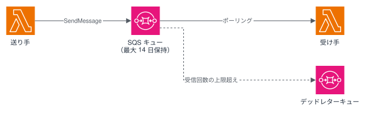
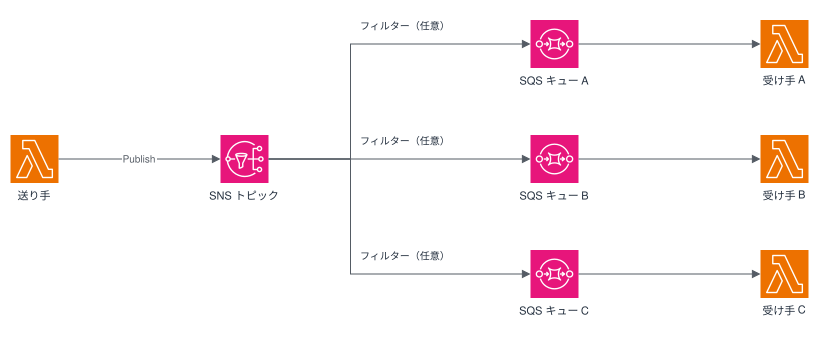
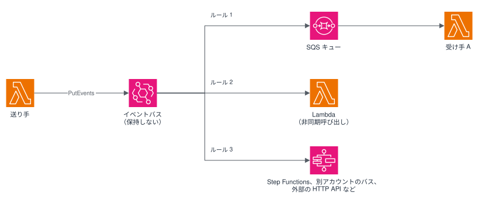
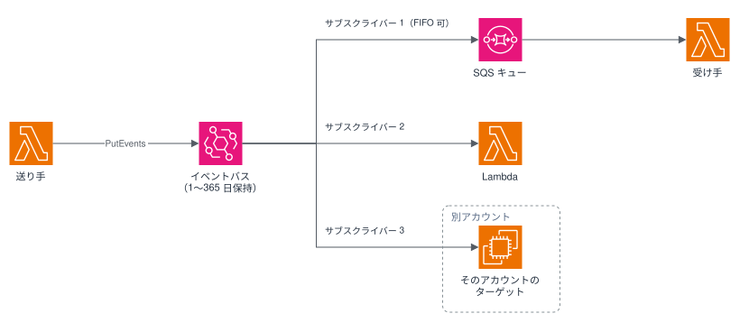
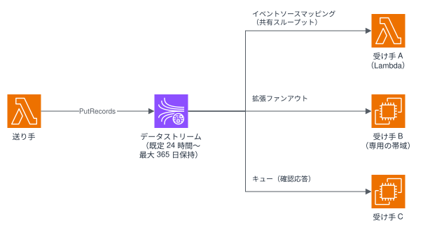

# AWS で非同期処理とイベント配信を組むときの部品

処理を呼び出し元から切り離して非同期に実行する構成と、一つのイベントを複数の受け手に配る pub/sub（出版と購読）の構成を、AWS でどの部品を使って組むかを比べる。
候補は **SQS 単体**、**SNS + SQS**、**EventBridge**、**Kinesis Data Streams** の四つである。

四つは、受け手の数と、メッセージを誰が持ち続けるかで分けられる。

- SQS 単体は、一つのキューに一つの処理を対応させる 1 対 1 の構成である。
- SNS + SQS と EventBridge は、一つのイベントを複数の受け手に配る 1 対多の構成である。SNS と従来の EventBridge では、配った先でメッセージを溜めるのは受け手ごとの SQS などである。2026 年 9 月に出た EventBridge の新しい Custom Event Bus は、バス自身がイベントを保持する。
- Kinesis Data Streams は、イベントを順序つきで一定期間保持し、複数の受け手がそれぞれ自分のペースで読む構成である。

本ファイルは [README](../README.md) の「クラウドごとの構成」の代わりに、AWS 内の四つの構成を並べる。
Google Cloud と Cloudflare の対応する構成は、別ファイルで扱う。

## 1. 解きたい課題と前提

非同期処理を入れる理由は、主に次の三つである。

- 時間のかかる処理（メール送信、画像変換、外部 API の呼び出しなど）を、利用者への応答から切り離す。
- 受け手が落ちていたり遅かったりしても、送り手を止めずにメッセージを溜めておき、あとで処理する。
- 一つの出来事（注文が確定した、など）を、在庫、通知、分析といった複数の処理に配り、送り手がそれぞれの受け手を知らなくて済むようにする。

前の二つは 1 対 1 の非同期処理でも満たせる。
三つ目が要るときに pub/sub の構成になる。

前提は次のとおりとする。

- 受け手は主に Lambda とし、ECS のタスクなどがキューを読む場合も扱う。
- メッセージは JSON で、1 件あたり 1 MiB 以下とする。
- メッセージは「少なくとも 1 回」届けばよく、受け手は同じメッセージを 2 回受け取っても結果が変わらない（冪等である）ように作る。四つとも、標準の使い方では重複配信がありうる。

## 2. 構成

<!-- 図は draw.io で images/async-messaging-*.drawio.svg を開けば編集できる -->

### A. SQS 単体



```
送り手 ─▶ SQS キュー ─▶ 受け手（Lambda のイベントソースマッピング、ECS など）
                │
                └─(受信回数の上限超え)─▶ デッドレターキュー
```

- 送り手は `SendMessage` でキューに入れ、受け手はキューからメッセージを取り出して処理し、終わったら削除する。Lambda はイベントソースマッピング（Lambda がキューをポーリングして関数を呼ぶ仕組み）で受け取る。
- 処理に失敗したメッセージは、可視性タイムアウトのあとに再び取り出せるようになる。決めた回数（`maxReceiveCount`）を超えるとデッドレターキュー（DLQ）に移り、原因を直したあとで元のキューに戻せる（再ドライブ）。
- メッセージは最大 14 日間保持される。受け手が長く止まっていても、その期間は失われない。
- 順序と重複排除が要る場合は FIFO キューを使う。FIFO キューはメッセージグループ ID ごとに順序を守り、重複排除 ID で 5 分間の重複を取り除く。
- 受け手を増やしたいときは、送り手が別のキューにも送る必要がある。送り手が受け手を知っている構成である。

### B. SNS + SQS（ファンアウト）



```
送り手 ─▶ SNS トピック ─┬─▶ SQS キュー A ─▶ 受け手 A
                        ├─▶ SQS キュー B ─▶ 受け手 B
                        └─▶ SQS キュー C ─▶ 受け手 C
```

- 送り手は SNS トピックに `Publish` し、トピックに登録された SQS キューそれぞれにメッセージのコピーが届く。受け手は自分のキューから A と同じように読む。
- SNS から Lambda に直接配ることもできる。ただし、バッチ処理、同時実行数による流量の調整、DLQ からの再ドライブ、長く止まったときの溜め置き（SQS なら最大 14 日）を受け手の側で制御できないので、受け手ごとに SQS を挟むのが定番である。
- サブスクリプション（購読）ごとにフィルターポリシーを付けると、条件に合うメッセージだけをそのキューに届けられる。条件は、メッセージ属性かメッセージ本文の JSON に対して書く[^sns-filter]。
- 順序が要る場合は、SNS FIFO トピックに SQS FIFO キューを登録する。メッセージグループ ID ごとの順序が、トピックから各キューまで守られる。
- 受け手を増やすには、新しいキューを作ってトピックに登録するだけでよく、送り手は変わらない。
- SNS から SQS に届くメッセージは、既定では SNS の封筒（`Type`、`Message` などを持つ JSON）に包まれる。サブスクリプションで未加工のメッセージ配信（raw message delivery）を有効にすると、送ったままの本文が届く。

### C. EventBridge

EventBridge のカスタムイベントバスには、2026 年 9 月から二つの種類がある[^eb-new]。
従来のバスは **Custom Event Bus - Classic** に改名され、新しく **Custom Event Bus** が加わった。
既存の API はそのまま使える。

#### C1. Custom Event Bus - Classic（ルールとターゲット）



```
送り手 ─▶ イベントバス ─┬─(ルール 1)─▶ SQS キュー ─▶ 受け手 A
                        ├─(ルール 2)─▶ Lambda（非同期呼び出し）
                        └─(ルール 3)─▶ Step Functions、別アカウントのイベントバス、外部の HTTP API など
```

- 送り手はイベントバスに `PutEvents` し、ルールのイベントパターンに合ったイベントが、そのルールのターゲットに届く。ルールあたりのターゲットは最大 5 つ、バスあたりのルールは既定で 300（引き上げ可能）である。
- イベントパターンは、イベントのどのフィールドでも条件にでき、前方一致、数値の範囲、存在の有無などで絞れる。B のフィルターポリシーより表現が豊かである。
- ターゲットに届けられなかったイベントは、既定で最大 24 時間、最大 185 回まで再試行される[^eb-retry]。それでも届かなければ、ターゲットごとに設定した DLQ（SQS キュー）に入る。
- バスはイベントを保持しない。保存しておきたい場合はアーカイブを作り、あとでリプレイ（イベントバスに流し直す）する。
- 順序の保証も、重複排除もない。

#### C2. Custom Event Bus（サブスクライバー）



```
送り手 ─▶ イベントバス（イベントを 1〜365 日保持）─┬─(サブスクライバー 1)─▶ SQS キュー
                                                  ├─(サブスクライバー 2)─▶ Lambda
                                                  └─(サブスクライバー 3、別アカウント)─▶ そのアカウントのターゲット
```

- ルールの代わりに **サブスクライバー** を作る。サブスクライバーはフィルターと、ただ一つのターゲットを持つ。複数のターゲットに配るには、ターゲットごとにサブスクライバーを作る。
- バスが、受け取ったすべてのイベントを設定した期間（1〜365 日、既定 1 日）保持する。サブスクライバーは開始位置を過去にして、保持されたイベントを読み直せる。止めていたサブスクライバーも、取りこぼさずに再開できる。
- イベントグループごとに、サブスクライバー単位で FIFO（順序つき）配信ができる。
- 公開時に、内容か指定したキーで 5 分間の重複排除ができる。
- `PutRawEvents` で、JSON 以外（Avro、Protobuf など）のイベントも公開できる。
- AWS RAM でバスを別アカウントと共有すると、そのアカウントが自分のサブスクライバーを作れる。バスを運用するチームが、受け手ごとのルーティングを書かなくて済む。
- 料金は、イベント数ではなく、公開、配信、保持のデータ量で決まる。
- 提供開始時点で使えるリージョンは、東京を含む 14 である。

#### C1 と C2 に共通すること

- AWS のサービス（S3、EC2、CodePipeline など）や SaaS が出すイベントも、同じ仕組みで受けられる。自分のアプリケーションのイベントと AWS のイベントを、同じ仕組みで扱える。
- スキーマレジストリでイベントの形を登録し、コードのバインディングを生成できる。

### D. Kinesis Data Streams



```
送り手 ─▶ Kinesis データストリーム（シャード）─┬─▶ 受け手 A（Lambda のイベントソースマッピング）
                                              ├─▶ 受け手 B（拡張ファンアウト）
                                              └─▶ 受け手 C（キュー）
```

- 送り手は `PutRecord(s)` でストリームに書き込む。レコードはパーティションキーでシャードに振り分けられ、シャードの中では書き込んだ順に並ぶ。
- レコードは読まれても消えず、保持期間（既定 24 時間、最大 365 日）のあいだ残る。複数の受け手が同じデータを、それぞれの位置から読める。過去の位置に戻って読み直すこともできる。
- 受け手の読み方は三つある。
  - **共有スループット**: シャードあたりの読み取り帯域（2 MB/秒）と `GetRecords` の呼び出し回数（5 回/秒）を、すべての受け手で分け合う。
  - **拡張ファンアウト**: 登録した受け手ごとに、シャードあたり 2 MB/秒の専用の読み取り帯域が付く。
  - **キュー**: 2026 年 11 月に追加された読み方である。受け手はシャードを意識せずにレコードを 1 件ずつ受け取り、処理が終わったら確認応答を返す[^kds-queue]。確認応答のないレコードは再配信される。既定では 6 回受け取られても確認応答がないとデッドレターとして脇に置かれ、この回数は 1〜1,000 で変えられる。中身は SQS で動いていて、シャード数を超えて受け手を増やせる。オンデマンドのストリームでだけ使える。
- Lambda のイベントソースマッピングで読む場合、シャードごとに順序を守って処理する。あるレコードの処理が失敗し続けると、そのシャードの後続のレコードが止まる。失敗したバッチを分割して再試行する設定、再試行回数の上限、失敗したレコードの送り先を決めておく必要がある。
- 拡張ファンアウトの受け手とキューの受け手は、合わせてストリームあたり 20（On-demand Advantage では、一部のリージョンで 50）までである。

## 3. トレードオフ

### 機能の差

| 観点                   | A: SQS 単体                               | B: SNS + SQS                                                                                                 | C1: EventBridge（Classic）                                      | C2: EventBridge（新しい Custom Event Bus）                                   | D: Kinesis Data Streams                                                                                                           |
| ---------------------- | ----------------------------------------- | ------------------------------------------------------------------------------------------------------------ | --------------------------------------------------------------- | ---------------------------------------------------------------------------- | --------------------------------------------------------------------------------------------------------------------------------- |
| 受け手の数             | 1 キュー = 1 処理                         | トピックあたり多数（FIFO トピックと、1 MiB を有効にしたトピックは 100 まで）                                 | ルールは既定 300、ルールあたりターゲット 5 つまで               | バスあたりサブスクライバー既定 10,000、サブスクライバーごとにターゲット 1 つ | 共有スループットは数の上限がないが、帯域と呼び出し回数を分け合うので実用上は数個まで。拡張ファンアウトとキューは合わせて 20 か 50 |
| 送り手と受け手の結合   | 送り手がキューを知っている                | 送り手はトピックだけを知っている                                                                             | 送り手はイベントバスだけを知っている                            | 同左。別アカウントの受け手も、自分でサブスクライバーを作る                   | 送り手はストリームだけを知っている                                                                                                |
| 絞り込み               | なし（受け手側で捨てる）                  | サブスクリプションごとのフィルターポリシー                                                                   | ルールのイベントパターン                                        | サブスクライバーのフィルター                                                 | なし（受け手側で捨てる。Lambda のイベントソースマッピングにはフィルターがある）                                                   |
| 順序                   | FIFO キューでメッセージグループごとに保証 | FIFO トピック + FIFO キューでメッセージグループごとに保証                                                    | 保証なし                                                        | イベントグループごと、サブスクライバーごとに FIFO 配信                       | シャード（パーティションキー）ごとに保証                                                                                          |
| 重複排除               | FIFO キューで 5 分間                      | FIFO トピックで 5 分間                                                                                       | なし                                                            | 公開時に 5 分間                                                              | なし                                                                                                                              |
| メッセージの保持       | 最大 14 日。処理して削除すると消える      | SNS は保持しない（FIFO トピックのアーカイブを除く）。各 SQS で最大 14 日                                     | バスは保持しない。アーカイブを作れば保存できる                  | バスが 1〜365 日保持する                                                     | 保持期間（既定 24 時間、最大 365 日）のあいだ、読まれても残る                                                                     |
| 読み直し               | できない                                  | FIFO トピックのアーカイブとリプレイのみ                                                                      | アーカイブからリプレイ                                          | サブスクライバーの開始位置を過去にする                                       | 任意の位置から読み直せる                                                                                                          |
| 失敗したメッセージ     | DLQ と再ドライブ                          | 各 SQS の DLQ。SNS から SQS への配信失敗用に、SNS 側にも DLQ を付けられる                                    | 既定で最大 24 時間の再試行のあと、ターゲットごとの DLQ          | 再試行（既定 5 回・300 秒）のあと DLQ                                        | Lambda では失敗したレコードの送り先を設定する。キューの受け手には組み込みのデッドレター処理がある                                 |
| 1 件の最大サイズ       | 1 MiB                                     | 1 MiB（トピックの `MaximumMessageSize` の設定が要る。256 KiB 超にすると配信先は SQS、Lambda、Firehose のみ） | 1 MB（一部のリージョンを除く）                                  | 執筆時点でクォータの表から確認できていない                                   | 既定 1 MiB、設定で最大 10 MiB（Lambda で読むなら 6 MiB まで）                                                                     |
| AWS サービスのイベント | 一部のサービスが SQS に直接送れる         | 一部のサービスが SNS に直接送れる                                                                            | 多くの AWS サービスと SaaS のイベントがそのまま届く             | イベントソースを作って取り込む                                               | なし                                                                                                                              |
| 受け手の種類           | キューを読めるもの                        | SQS、Lambda、HTTP、メール、SMS など（1 MiB を有効にしたトピックは SQS、Lambda、Firehose のみ）               | 20 種類以上の AWS サービス、別アカウントのバス、外部の HTTP API | 250 以上の AWS サービス                                                      | Lambda、KCL のアプリケーション、Firehose、Flink など                                                                              |
| 提供リージョン         | すべて                                    | すべて                                                                                                       | すべて                                                          | 東京を含む 14（提供開始時点）                                                | すべて                                                                                                                            |

各サービスのサイズの上限は、2025 年から 2026 年にかけて 256 KiB から 1 MiB 前後に引き上げられた[^size]。
古い記事にある「256 KB を超えたら S3 に置く」という前提は、いまは当てはまらないことが多い。

C2 は、B と C1 と D の性質をあわせ持つ。
pub/sub の振り分け（B、C1）に加えて、保持、読み直し、順序（D）がバスに組み込まれている。
新しいサービスなので、使うリージョンと、IaC ツールの対応状況を確認してから選ぶ。

### 性能

- A と B は、送ってから受け手が受け取るまでの遅延が小さい。Lambda のイベントソースマッピングは、メッセージが来るまでロングポーリングで待つ。
- C は、ルールやフィルターの評価とターゲットへの配信が入る分、A と B より遅延が大きくなりやすい。遅延の上限を厳しく求める処理には向かない。
- D は、書き込みの帯域をシャード数（またはオンデマンドの自動拡張）で決める。大量のデータを順序つきで流すのに向く。共有スループットで読む受け手が増えると、帯域と呼び出し回数を取り合って遅れる。
- Lambda で受ける場合の並列度は、A と B ではキューのメッセージ数に応じて自動で増え、最大同時実行数で上限を決められる。D ではシャード数と並列化係数（シャードあたり最大 10）で決まる。
- 順序を守る単位（A と B の FIFO のメッセージグループ、C2 のイベントグループ、D のシャード）の中では、一つずつしか処理できない。単位の数が少ないと、並列度が上がらない。

### コスト

us-east-1 の執筆時点の単価で、主なものは次のとおりである[^price]。

| 構成            | 課金のしかた                                                                                           | 単価の目安（64 KB 以下のメッセージ）                                                      |
| --------------- | ------------------------------------------------------------------------------------------------------ | ----------------------------------------------------------------------------------------- |
| A: SQS          | API リクエスト数（送信、受信、削除のそれぞれ）。64 KB ごとに 1 リクエストとして数える                  | 100 万リクエストあたり、標準キュー 0.40 USD、FIFO キュー 0.50 USD                         |
| B: SNS + SQS    | 標準トピックは `Publish` 数。SNS から SQS への配信は無料。各 SQS の受信と削除は A と同じ               | 標準トピックの `Publish` は 100 万件あたり 0.50 USD。加えて受け手ごとの SQS の料金        |
| C1: EventBridge | 自分のアプリケーションが送るイベント数。64 KB ごとに 1 件として数える。AWS サービスのイベントは無料    | 100 万件あたり 1.00 USD。加えてターゲット側（SQS など）の料金                             |
| C2: EventBridge | 公開、配信、保持のデータ量                                                                             | 件数ではなくデータ量で決まる                                                              |
| D: Kinesis      | オンデマンドはストリームの時間料金と、書き込み・読み取りのデータ量。プロビジョンドはシャードの時間料金 | 件数ではなくデータ量で決まる。On-demand Standard ではストリームがあるだけで固定費がかかる |

- A は、1 件を送って受けて消すと 3 リクエストになる。バッチ（最大 10 件）を使わなければ、1 件あたりの費用は 100 万件で約 1.20 USD（標準キュー）である。それでも四つのなかで最も安く、無料枠（毎月 100 万リクエスト）もある。ロングポーリングにしておかないと、空の受信リクエストにも課金される。
- B は、受け手の数だけ SQS の料金が増える。SNS の料金は受け手の数によらず `Publish` 1 回分である。FIFO トピックは、`Publish` の件数とデータ量、配信の件数で課金され、標準トピックと体系が違う。
- C1 は件数あたりの単価が B の `Publish` の 2 倍だが、絞り込みや変換をルール側で済ませられる分、受け手の Lambda の起動回数が減る場合がある。
- C2 はデータ量で課金されるので、小さなイベントを大量に流す場合は C1 より安くなりうる。保持期間を長くすると、その分の保持の料金がかかる。
- D は、件数が多くデータが小さい場合に、件数で課金される構成より安くなることがある。一方、On-demand Standard ではストリームごとの時間料金がかかり、件数が少なくても固定費が出る。On-demand Advantage はストリームごとの固定費がない代わりに、アカウント全体で書き込みと読み取りそれぞれ 25 MiB/秒の最低利用量がある。us-east-1 では最低でも 1 日約 100 USD になり、有効にすると 24 時間は無効にできない。本ファイルが想定する規模の非同期処理には過大である。
- Lambda の料金は、どの構成でも同じ料金体系である。ただし、バッチで受け取れる構成（A、B、C2、D）は、イベント 1 件ごとに呼び出される C1 の Lambda 直結より、起動回数を減らしやすい。

### 運用負荷

- A は部品が一つで、設定はキュー、DLQ、イベントソースマッピングだけである。最も単純である。Lambda で読む場合、キューの可視性タイムアウトは関数のタイムアウトの 6 倍以上にするのが推奨である。
- B は、トピック、受け手ごとのキュー、サブスクリプション、キューのアクセスポリシー（SNS からの送信を許可する）を揃える必要がある。受け手が増えるたびにこの組を作る。
- C1 は、ルールとイベントパターンが増えると、どのイベントがどこに届くかを追いにくくなる。イベントパターンを書き間違えると、イベントはエラーにならずに捨てられる。ルールごとのメトリクス（`MatchedEvents`、`FailedInvocations`）を見る。存在しないイベントバスに `PutEvents` しても成功が返り、イベントは捨てられる点にも注意する。
- C1 から Lambda を直接呼ぶと非同期呼び出しになる。EventBridge が再試行するのは Lambda に渡せなかったとき（スロットリングなど）で、関数のエラーに対する再試行は Lambda 側で行われる。失敗の扱いが二か所に分かれるので、両方を設定する。受け手が止まったときに溜めておきたいなら、ターゲットを SQS にしてから Lambda で読む。
- C2 は、受け手を増やすときにバスを運用するチームの作業が要らない。別アカウントのチームが、自分でサブスクライバーを作る。組織の中でイベントを共有する場合に、運用の分担が楽になる。
- D は、シャード数（プロビジョンドの場合）、読み取りの位置、失敗したレコードの扱いを設計する必要がある。とくに Lambda で読む場合、失敗し続けるレコードがシャードを止める問題（いわゆる毒メッセージ）への対策は必須である。キューの読み方を使えば、この部分は A に近い扱いになる。
- EventBridge Pipes を使うと、SQS や Kinesis から読んだメッセージを絞り込み、加工してからターゲットに送れる。A と D に絞り込みを足したい場合に使える。
- どの構成でも、受け手は冪等に作る。FIFO や C2 の重複排除も 5 分間だけなので、それより長い間隔の重複は受け手で防ぐ。

### ロックイン

- A と B は、ほかのクラウドのキューや pub/sub（Google Cloud の Pub/Sub、Cloudflare の Queues など）と概念が近く、移しやすい。SNS のフィルターポリシーやメッセージ属性に頼った分は書き直しになる。
- C は、イベントパターン、AWS サービスのイベント、ターゲットの種類の豊富さに頼るほど、ほかに移しにくい。C2 の AWS RAM による共有も AWS 固有である。
- D は、Kafka（Amazon MSK を含む）とモデルが近く、パーティションと読み取り位置という考え方はそのまま持っていける。キューの読み方は Kinesis 固有である。

## 4. 選ぶ基準

A（SQS 単体）が向くのは次のような場合である。

- 受け手が一つで、今後も増える見込みが小さい。
- 時間のかかる処理を利用者への応答から切り離したい、という典型的な非同期処理である。
- 最も安く、最も単純に組みたい。

B（SNS + SQS）が向くのは次のような場合である。

- 一つのイベントを複数の受け手に配り、受け手ごとに処理の速さや失敗の扱いを独立させたい。
- 受け手ごとの絞り込みが、メッセージ属性か本文の単純な条件で書ける。
- 順序が要る pub/sub（FIFO トピック + FIFO キュー）を、実績のある部品で組みたい。

C1（EventBridge Classic）が向くのは次のような場合である。

- 絞り込みの条件が複雑で、受け手ごとにルールで振り分けたい。
- AWS のサービスや SaaS のイベントと、自分のアプリケーションのイベントを同じ仕組みで扱いたい。
- 別アカウントや外部の HTTP API にイベントを届けたい。
- 順序が要らず、A と B より遅延が大きくなってもよい。

C2（新しい Custom Event Bus）が向くのは次のような場合である。

- 複数のアカウントやチームでイベントを共有し、受け手のチームが自分で購読を追加できるようにしたい。
- pub/sub に、順序、重複排除、保持と読み直しも求める。
- 使うリージョンが対応していて、新しいサービスを採用できる。

D（Kinesis Data Streams）が向くのは次のような場合である。

- ログ、クリックストリーム、IoT のデータのように、大量のデータを順序つきで流す。
- 同じデータを複数の受け手が、それぞれ自分のペースで、ときには過去に戻って読む。
- 一定期間データを保持し、新しい受け手を追加したときに過去分から処理させたい。

迷った場合の進め方は次のとおりである。

1. 受け手が一つなら A から始める。受け手が増えたら、送り手を SNS トピックに向け直して B に移す。サブスクリプションで未加工のメッセージ配信を有効にし、キューのアクセスポリシーで SNS からの送信を許可すれば、キューと受け手はそのまま使える。
2. 受け手が複数で、絞り込みが単純なら B、複雑か AWS のイベントも扱うなら C1 を選ぶ。複数のアカウントで共有するバスを作る、あるいは順序や読み直しも要るなら、C2 を検討する。
3. 読み直しや長期の保持が要る、またはデータ量が多く件数課金が重いなら、D か C2 を検討する。

B と C1 はどちらも pub/sub で、迷いやすい。
目安として、受け手がすべて自社のキューで、順序や遅延が大事なら B、受け手の種類が多く、イベントの種類で細かく振り分けたいなら C1 である。
C1 のターゲットに SQS を置けば、C1 の振り分けと、A の溜めておく性質を組み合わせられる。

[^sns-filter]: [Amazon SNS message filtering](https://docs.aws.amazon.com/sns/latest/dg/sns-message-filtering.html) を参照。1 MiB のメッセージを有効にしたトピックの制約は [Large message payloads](https://docs.aws.amazon.com/sns/latest/dg/large-message-payloads.html) を参照。

[^eb-new]: [Amazon EventBridge relaunches event buses for enterprise scale](https://aws.amazon.com/about-aws/whats-new/2026/09/eventbridge-relaunches-custom-event-buses/) と [What is the EventBridge Custom Event Bus?](https://docs.aws.amazon.com/eventbridge/latest/userguide/eb-custom-bus-what-is.html) を参照。本ファイルの C2 の記述は 2026 年 11 月時点の情報である。

[^eb-retry]: Classic のルールのターゲットの既定値である。上限は [RetryPolicy](https://docs.aws.amazon.com/eventbridge/latest/APIReference/API_RetryPolicy.html) を参照。

[^kds-queue]: [Amazon Kinesis Data Streams announces queues](https://aws.amazon.com/about-aws/whats-new/2026/11/kinesis-data-streams-queues/) と [Handle dead-letter records in a queue](https://docs.aws.amazon.com/streams/latest/dev/queues-dead-letter-records.html) を参照。本ファイルの記述は 2026 年 11 月時点の情報である。

[^size]: [SQS（2025 年 8 月）](https://aws.amazon.com/about-aws/whats-new/2025/08/amazon-sqs-max-payload-size-1mib/)、[EventBridge（2026 年 1 月。ニュージーランド、タイ、マレーシア、台北、メキシコ中部の各リージョンを除く）](https://aws.amazon.com/about-aws/whats-new/2026/01/amazon-eventbridge-increases-event-payload-size-256-kb-1-mb/)、[SNS（2026 年 9 月）](https://aws.amazon.com/about-aws/whats-new/2026/09/amazon-sns-1mib-support/) の発表を参照。Kinesis Data Streams のレコードサイズは [Large records](https://docs.aws.amazon.com/streams/latest/dev/large-records.html) を参照。

[^price]: 単価はリージョンと利用量の段階によって変わる。最新の値は [Amazon SQS の料金](https://aws.amazon.com/sqs/pricing/)、[Amazon SNS の料金](https://aws.amazon.com/sns/pricing/)、[Amazon EventBridge の料金](https://aws.amazon.com/eventbridge/pricing/)、[Amazon Kinesis Data Streams の料金](https://aws.amazon.com/kinesis/data-streams/pricing/) を参照。
