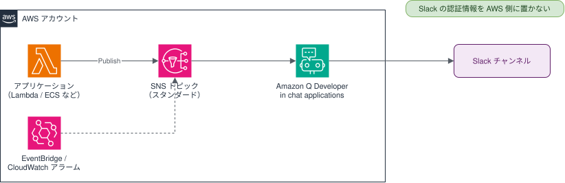
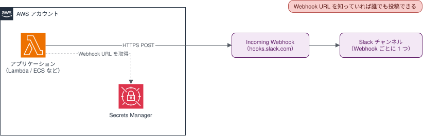
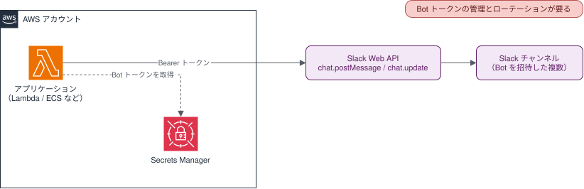

# AWS 上のアプリケーションから Slack に通知を送る仕組み

AWS 上で動くアプリケーションから、Slack のチャンネルにメッセージを送る仕組みを比べる。
主に扱うのは **SNS + Amazon Q Developer in chat applications（旧 AWS Chatbot）** で、比較の対象として、自分で作った Slack app から送る **Incoming Webhook** と **Bot トークン + `chat.postMessage`** を並べる。

AWS Chatbot は 2025 年 2 月に Amazon Q Developer in chat applications に名前が変わった[^rename]。
API、SDK のエンドポイント、IAM のアクション名、CloudFormation のリソース名は `chatbot` のまま変わっていない。
本ファイルでは、以下「Q Developer」と略す。

本ファイルは [README](../README.md) の「クラウドごとの構成」の代わりに、AWS 内の三つの構成を並べる。

## 1. 解きたい課題と前提

アプリケーション固有の出来事（バッチの完了や失敗、業務上の異常、利用者の操作など）を、決まった Slack チャンネルに知らせたい。
CloudWatch アラームのような AWS サービスの通知だけなら A の構成で済むことが多い。
迷いやすいのは、アプリケーションが自分でメッセージを組み立てて送る場合である。

前提は次のとおりとする。

- 送り手は Lambda、ECS のタスク、EC2 などで動くアプリケーションで、VPC の中にあることもある。
- 通知は AWS から Slack への一方向とする。Slack のボタンやスラッシュコマンドから AWS 側を操作する双方向の仕組みは主題にしないが、構成の違いとして触れる。
- 通知の量は、一つのチャンネルにつき平均で毎秒 1 件を超えない程度とする。Slack は、どの方法で投稿しても、一つのチャンネルにつき毎秒 1 件程度を上限にしている（短いバーストは許される）[^slack-rate]。
- どの構成でも、Slack ワークスペースへの Slack app のインストールが要る。A では Q Developer の Slack app、B と C では自分で作った Slack app である。ワークスペースの設定によっては、インストールに Slack の管理者の承認が要る。

## 2. 構成

<!-- 図は draw.io で images/slack-notification-*.drawio.svg を開けば編集できる -->

### A. SNS + Amazon Q Developer in chat applications



- 初回だけ、Q Developer のコンソールで Slack ワークスペースを認可する。この操作はブラウザでの OAuth の同意なので、コンソールで手で行う。
- 通知先のチャンネルごとに、Q Developer の「チャンネル設定」を作り、SNS トピックを紐づける。プライベートチャンネルに送る場合は、チャンネルで `/invite @Amazon Q` を実行して招待しておく。
- チャンネル設定には IAM ロール（チャンネルロール）とガードレールポリシーを付ける。通知を受けるだけなら、テンプレートの「Notification permissions」で足りる。
- SNS トピックはスタンダードにする。FIFO トピックは HTTPS のエンドポイントに配信できないので使えない[^getting-started]。トピックを KMS で暗号化する場合は、AWS マネージドキーではなくカスタマーマネージドキーを使い、送り手のサービスにキーの利用を許可する[^getting-started]。
- アプリケーションに要る権限は、トピックへの `sns:Publish` だけである。**Slack の認証情報をアプリケーションも AWS アカウントも持たない。**
- アプリケーションは、決められた形式（カスタム通知）の JSON を文字列にして SNS に Publish する[^custom]。

```json
{
  "version": "1.0",
  "source": "custom",
  "content": {
    "textType": "client-markdown",
    "title": ":warning: 月次集計バッチが失敗しました",
    "description": "対象月: 2026-10\nエラー: `TimeoutError`\ncc: <@U0123456789>",
    "nextSteps": ["<https://example.com/runbook|手順書> を確認する"],
    "keywords": ["batch", "critical"]
  },
  "metadata": {
    "threadId": "monthly-batch-2026-10",
    "summary": "月次集計バッチの状況"
  }
}
```

- `version`、`source`、`content.description` が必須である。形式が合わないメッセージは Slack に届かず、Q Developer の CloudWatch Logs に「Event Received is not supported」と記録される[^troubleshoot]。
- 本文は Slack の mrkdwn で書け、絵文字とユーザー ID によるメンション（`<@U...>`）が使える。`title` は 250 文字、`description` は 8,000 文字までである[^custom]。
- `metadata.threadId` が同じ通知は、一つのスレッドにまとめられる。チャンネルの設定（`@Amazon Q preferences`）でスレッドへの通知を許可しておく必要があり、まとめるかどうかは設定した時間の幅で決まる[^custom]。
- 表示の形は Q Developer が決める。Block Kit（Slack のレイアウト部品）で自由に組むことはできず、投稿者は「Amazon Q」に固定され、末尾に「Custom notification delivered by Amazon Q Developer in chat applications」というフッターが付く[^custom]。投稿したメッセージをあとから書き換えたり消したりする API もない。
- 同じトピックとチャンネルで、CloudWatch アラーム、EventBridge のイベント、Security Hub の検出結果など、Q Developer が対応している AWS サービスの通知も受けられる。EventBridge の input transformer で、AWS サービスのイベントをカスタム通知の形式に変えて送ることもできる[^custom]。
- 一つのチャンネル設定に、複数のリージョンの SNS トピックを紐づけられる[^subscribe]。ほかのアカウントの通知は、EventBridge で Q Developer のあるアカウントに集めれば、Q Developer を各アカウントに設定しなくて済む[^eventbridge]。

### B. Slack app の Incoming Webhook



- 自分で Slack app を作り、Incoming Webhooks を有効にしてワークスペースにインストールする。インストールのときに選んだチャンネルごとに、`https://hooks.slack.com/services/...` の URL が発行される。
- アプリケーションは、その URL に JSON を HTTPS で POST する。Block Kit が使えるので、表示の自由度は A より高い。
- **URL そのものが認証情報である。** URL を知っていれば誰でもそのチャンネルに投稿できるので、Secrets Manager か SSM Parameter Store の SecureString に置き、アプリケーションは実行時に読み出す。漏れた場合は、Slack app の設定画面で Webhook を無効にして作り直す。
- 投稿先のチャンネル、投稿者名、アイコンは Slack app の設定で決まり、メッセージ側で上書きできない[^slack-webhook]。チャンネルを増やすたびに Webhook を一つ増やす。
- 応答は `ok` という文字列だけで、投稿したメッセージの識別子（`ts`）が返らない。そのため、投稿したメッセージをあとから書き換えたり、それを親にしてスレッドに返信したりはできない。
- アプリケーションが VPC の中にある場合は、`hooks.slack.com` に出るための NAT ゲートウェイなどのインターネットへの出口が要る。

アプリケーションから直接 POST する代わりに、SNS（または SQS）の後ろに Webhook を呼ぶ Lambda を置く形もある。
アプリケーションは A と同じく `sns:Publish` だけを持てばよくなり、Webhook URL を読む権限と、Slack の応答の失敗や 429 の再試行を、その Lambda に寄せられる。

#### コードを書かずに送る: EventBridge API destinations

EventBridge の API destinations を使うと、EventBridge のイベントを、Lambda を書かずに Webhook に送れる[^api-dest]。

```
アプリケーション ─▶ EventBridge（ルール + input transformer）─▶ API destination ─▶ Incoming Webhook
```

- input transformer で、イベントを Slack が受け取る JSON（`text` や `blocks`）に組み替える。
- API destination の「接続（connection）」は、認証の方式（API キー、Basic、OAuth）の指定が必須である。Webhook は URL だけで認証するので、使わないヘッダーを API キーとして入れておくことになる。接続の認証情報は EventBridge が Secrets Manager に保存し、その費用は API destinations の料金に含まれる。
- 呼び出しの上限を毎秒 1〜300 件で指定でき、超えた分は EventBridge が待たせて送る。送れなかったイベントは最大 24 時間再試行し、それでも失敗したものは、ターゲットに設定したデッドレターキュー（SQS）に残せる[^api-dest]。
- Webhook URL は API destination のエンドポイントとして EventBridge の設定に入るので、URL を Terraform の state などに置かないように扱いに注意する。
- 呼び出し 100 万件あたり 0.20 USD かかる[^price]。

### C. Slack app の Bot トークン + `chat.postMessage`



- 自分で Slack app を作り、Bot に `chat:write` スコープを付けてインストールすると、Bot トークン（`xoxb-...`）が発行される。Bot をチャンネルに招待するか、`chat:write.public` スコープを付ければ公開チャンネルに招待なしで送れる。
- アプリケーションは、トークンを `Authorization: Bearer` ヘッダーに付けて `chat.postMessage` を呼ぶ。投稿先のチャンネルはリクエストごとに指定できるので、トークン一つで複数のチャンネルに送れる。
- 応答に投稿したメッセージの `ts` が返る。これを使って、`thread_ts` でスレッドに返信したり、`chat.update` で「処理中」を「完了」に書き換えたり、`chat.delete` で消したりできる。ファイルのアップロードもできる。
- トークンも B の URL と同じく Secrets Manager に置く。トークンのローテーションを有効にすると、トークンは 12 時間で期限が切れ、リフレッシュトークンでの更新が要る。有効にしない場合は、漏れたときに Slack app の設定画面でトークンを取り消して再インストールする。
- 公式の SDK（Python の `slack_sdk`、Node.js の `@slack/web-api`）は、429 と `Retry-After` ヘッダーによる再試行を扱える。
- のちに Slack のボタンやスラッシュコマンドで AWS 側の処理を動かしたくなったら、同じ Slack app に機能を足せる。ただし、Slack からのリクエストを受ける公開 HTTPS エンドポイント（API Gateway や Lambda 関数 URL など）が別に要る。
- VPC の中から送る場合に、インターネットへの出口が要るのは B と同じである。

B と同じく、SNS や SQS の後ろに投稿用の Lambda を置けば、トークンを読む権限をその Lambda だけに持たせられる。

## 3. トレードオフ

| 観点                                 | A. SNS + Q Developer                                                   | B. Incoming Webhook                                      | C. Bot トークン + `chat.postMessage`            |
| ------------------------------------ | ---------------------------------------------------------------------- | -------------------------------------------------------- | ----------------------------------------------- |
| Slack 側の準備                       | Q Developer の Slack app をインストールし、チャンネルに招待            | 自作の Slack app を作り、チャンネルごとに Webhook を発行 | 自作の Slack app を作り、Bot をチャンネルに招待 |
| アプリケーションが持つ認証情報       | なし（IAM の `sns:Publish` だけ）                                      | Webhook URL                                              | Bot トークン                                    |
| 送り先                               | SNS（AWS の API）                                                      | `hooks.slack.com`                                        | `slack.com/api`                                 |
| VPC の中から送るときの出口           | SNS のインターフェイス VPC エンドポイントがあれば NAT は不要           | NAT ゲートウェイなどが要る                               | NAT ゲートウェイなどが要る                      |
| 一つの送り口で送れるチャンネル       | トピックに紐づけたチャンネル（設定で増やせる）                         | Webhook ごとに 1 チャンネル                              | Bot が送れるチャンネルならどこでも              |
| 表示の自由度                         | タイトル、本文、次の手順、キーワードの決まった形。Block Kit は使えない | Block Kit が使える                                       | Block Kit が使える                              |
| 投稿者名とアイコン                   | 「Amazon Q」に固定。フッターも固定                                     | Slack app の設定で決まる                                 | Slack app の設定で決まる                        |
| スレッド                             | `threadId` で Q Developer がまとめる（時間の幅による）                 | できない（`ts` が返らない）                              | `thread_ts` で自由に返信できる                  |
| 投稿後の書き換え、削除               | できない                                                               | できない                                                 | `chat.update`、`chat.delete` でできる           |
| AWS サービスの通知との同居           | 同じトピックとチャンネルで受けられる                                   | 別の仕組み（EventBridge API destinations など）が要る    | 別の仕組みが要る                                |
| 送信の失敗がアプリケーションに返るか | 返らない（Publish が成功した時点で終わる）                             | 返る（HTTP のステータス）                                | 返る（HTTP のステータスと `ok: false`）         |
| 料金                                 | Q Developer は追加料金なし。SNS の料金だけ                             | Secrets Manager の料金（と NAT）                         | Secrets Manager の料金（と NAT）                |
| Slack 以外への載せ替え               | Microsoft Teams なら同じ仕組みで送れる                                 | Slack 専用                                               | Slack 専用                                      |

### 認証情報の置き場所

A の最大の利点は、Slack の認証情報をどこにも持たないことである。
Slack との認可は Q Developer と Slack のあいだで済んでおり、AWS 側で管理するのは IAM の権限だけになる。
漏えいや取り消しを気にする対象が増えず、誰が送れるかを IAM ポリシーとトピックのアクセスポリシーで説明できる。

B と C は、Webhook URL や Bot トークンを Secrets Manager に置き、読める主体を絞り、漏れたときの作り直しの手順を持っておく必要がある。
B の URL は投稿しかできないが、C の Bot トークンはスコープ次第でチャンネルの履歴を読むなどもできるので、漏れたときの影響は C のほうが大きい。
スコープは `chat:write` などの必要なものだけにしておく。

### 表現力

業務上の通知で困るのは、A の表示の固定である。
次のようなことは A ではできず、C を選ぶ理由になる。

- Block Kit でボタンや表、画像を組む。
- 一つの処理の進み具合を、一つのメッセージを書き換えて見せる。
- 処理ごとに必ずスレッドを分け、あとから決まった親メッセージに返信する。A の `threadId` は、設定した時間の幅のなかでまとめる仕組みなので、時間をおいた続報が同じスレッドに入るとは限らない。
- 送り手の名前やアイコンをシステムごとに変える。

一方で、運用のアラートや「失敗した」「終わった」程度の知らせなら、A の決まった形（タイトル、本文、次の手順、キーワード）で足りることが多い。
B は Block Kit が使えるが、投稿後に手を出せないので、表現力は「一回きりのメッセージを凝って作れる」までである。

### 失敗の検知と再試行

A は非同期である。
アプリケーションから見えるのは SNS への Publish の成功までで、その先で Slack に届かなかったことは分からない。
届かなかったことは、Q Developer の CloudWatch メトリクス（`MessageDeliveryFailure`、`UnsupportedEvents`、`EventsThrottled`）と CloudWatch Logs で見る[^metrics]。
これらのメトリクスはバージニア北部リージョン（`us-east-1`）に出るので、アラームもそこに作る。
特に、カスタム通知の形式の誤りは、送り手には何も返らないまま捨てられる。
JSON を組み立てるコードを変えたら、実際のチャンネルに届くかを確かめる。
Q Developer は、受け取った通知が毎秒 10 件を超えると間引くことがある[^metrics]。

B と C は同期である。
Slack の応答（2xx、4xx、429）がそのままアプリケーションに返るので、失敗をログに残したり、再試行したりできる。
その代わり、Slack の障害や 429 の扱いをアプリケーションが受け持つ。
通知の失敗で本来の処理を止めたくない場合は、SNS や SQS の後ろに投稿用の Lambda を置いて切り離す。

### コスト

どの構成も、通知の件数が数万件 / 月程度なら、料金はほぼ無視できる[^price]。

- A は、Q Developer の通知に追加料金がない[^custom]。SNS は Publish 100 万件あたり 0.50 USD（最初の 100 万件 / 月は無料）で、ほかに配信の料金がかかる。
- B と C は、Secrets Manager にシークレット一つあたり月 0.40 USD と、API 呼び出し 1 万件あたり 0.05 USD がかかる。呼び出しのたびにシークレットを読まず、実行環境の中でキャッシュする。
- 差が出るのは、VPC の中から送る場合の出口である。A は SNS のインターフェイス VPC エンドポイント（東京で 1 AZ あたり月約 10 USD）で済み、すでに VPC エンドポイントがあれば追加はない。B と C は、NAT ゲートウェイがない VPC から送るためにわざわざ置くと、3 AZ で月約 136 USD の固定費になる。NAT ゲートウェイの費用の内訳は [Lambda を内部 API として呼び出すときの入口](lambda-internal-api.md#コスト) を参照。

### 運用負荷

- A の Slack ワークスペースの認可はコンソールでの手作業だが、一度だけである。チャンネル設定、IAM ロール、SNS トピックとの紐づけは、Terraform（`aws_chatbot_slack_channel_configuration`）や CloudFormation（`AWS::Chatbot::SlackChannelConfiguration`）で管理できる。認可したワークスペースの ID とチャンネルの ID をコードに書く。
- A では、Slack のチャンネル名を変えても ID は変わらないので設定は壊れない。プライベートチャンネルに変えた場合や、Q Developer をチャンネルから外した場合は届かなくなる。
- B と C は、Slack app の設定（スコープ、Webhook、インストール先）を Slack の管理画面で持つ。Slack app の設定はマニフェスト（YAML / JSON）で書けるが、AWS のリソースと同じ IaC で管理するには工夫が要る。
- B はチャンネルを増やすたびに Webhook とシークレットが増える。C はトークン一つで済むが、Bot を新しいチャンネルに招待し忘れると `not_in_channel` で失敗する。
- C で Slack app の機能を増やすと、スコープの追加のたびに再インストール（と、場合によっては管理者の承認）が要る。

### ロックイン

A は Q Developer のカスタム通知の形式に依存する。
ただし形式は小さく、通知を組み立てる関数を差し替えれば B や C に移れる。
同じ設定で Microsoft Teams にも送れるので、チャットツールを替える可能性がある組織では A のほうが移りやすい。

B と C は Slack の API に依存するが、AWS には依存しない。
AWS の外（ほかのクラウドや CI）からも同じ Slack app で送れる。

## 4. 選ぶ基準

A（SNS + Q Developer）が向くのは次のような場合である。

- 運用のアラートや、バッチの成否のような、決まった形で足りる通知である。
- CloudWatch アラームや EventBridge など、AWS サービスの通知と同じチャンネルにまとめたい。
- Slack の認証情報を AWS 側に置きたくない。誰が送れるかを IAM で説明したい。
- 送り手が VPC の中にあり、NAT ゲートウェイを置きたくない。
- 複数のアカウントやリージョンの通知を、一か所の設定で受けたい。

B（Incoming Webhook）が向くのは次のような場合である。

- 決まった一つか少数のチャンネルに、Block Kit で整えた一回きりのメッセージを送る。
- スレッドや投稿後の書き換えは要らない。
- AWS 以外の場所からも同じ方法で送りたい。
- コードを書かずに EventBridge のイベントを Slack 向けに整形して送りたい（API destinations を使う）。

C（Bot トークン + `chat.postMessage`）が向くのは次のような場合である。

- 利用者や業務部門が読む通知で、見た目や投稿者名を作り込みたい。
- 一つの処理の進み具合をメッセージの書き換えやスレッドで見せたい。
- 送り先のチャンネルを、通知の内容に応じて動的に変えたい。
- のちに Slack のボタンやスラッシュコマンドで AWS 側を操作する双方向の仕組みに広げる予定がある。

迷った場合は、運用の通知を A に寄せ、業務の通知だけを C で作る組み合わせが扱いやすい。
A を入れておけば、AWS サービスの通知とアプリケーションの通知の入口が SNS にそろい、あとから一部を C に切り出すときも、SNS の後ろに投稿用の Lambda を足すだけで済む。

[^rename]: [AWS Chatbot is now named Amazon Q Developer](https://aws.amazon.com/blogs/devops/aws-chatbot-is-now-named-amazon-q-developer/) を参照。本ファイルの記述は 2026 年 11 月時点の情報である。

[^slack-rate]: Slack の [Rate limits](https://docs.slack.dev/apis/web-api/rate-limits) を参照。`chat.postMessage` と Incoming Webhook のどちらにも適用される。

[^getting-started]: [Getting started with Amazon Q Developer in chat applications](https://docs.aws.amazon.com/chatbot/latest/adminguide/getting-started.html) の Setting up Amazon SNS topics を参照。

[^custom]: [Custom notifications using Amazon Q Developer in chat applications](https://docs.aws.amazon.com/chatbot/latest/adminguide/custom-notifs.html) を参照。カスタム通知に追加料金がないことも同ページに記載がある。

[^troubleshoot]: [Why doesn't my Amazon Q Developer receive messages from Amazon SNS?](https://repost.aws/knowledge-center/sns-aws-chatbot-message-troubleshooting) を参照。

[^subscribe]: [Tutorial: Subscribing an Amazon SNS topic to Amazon Q Developer in chat applications](https://docs.aws.amazon.com/chatbot/latest/adminguide/subscribe-sns-topic.html) を参照。

[^eventbridge]: [Tutorial: Creating an Amazon EventBridge rule that sends notifications to Amazon Q Developer in chat applications](https://docs.aws.amazon.com/chatbot/latest/adminguide/create-eventbridge-rule.html) の Step 2 を参照。

[^metrics]: [Monitoring Amazon Q Developer in chat applications with Amazon CloudWatch](https://docs.aws.amazon.com/chatbot/latest/adminguide/monitoring-cloudwatch.html) と [Accessing Amazon CloudWatch Logs for Amazon Q Developer in chat applications](https://docs.aws.amazon.com/chatbot/latest/adminguide/cloudwatch-logs.html) を参照。

[^slack-webhook]: Slack の [Sending messages using incoming webhooks](https://docs.slack.dev/messaging/sending-messages-using-incoming-webhooks/) を参照。

[^api-dest]: [Using API destinations with Amazon EventBridge](https://aws.amazon.com/blogs/compute/using-api-destinations-with-amazon-eventbridge/) を参照。

[^price]: 単価はリージョンと利用量の段階によって変わる。最新の値は [Amazon SNS の料金](https://aws.amazon.com/sns/pricing/)、[AWS Secrets Manager の料金](https://aws.amazon.com/secrets-manager/pricing/)、[Amazon EventBridge の料金](https://aws.amazon.com/eventbridge/pricing/)、[AWS PrivateLink の料金](https://aws.amazon.com/privatelink/pricing/)、[Amazon VPC の料金](https://aws.amazon.com/vpc/pricing/)（NAT ゲートウェイ）を参照。
