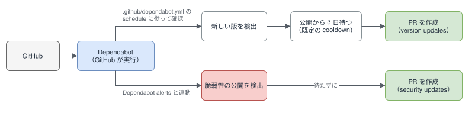
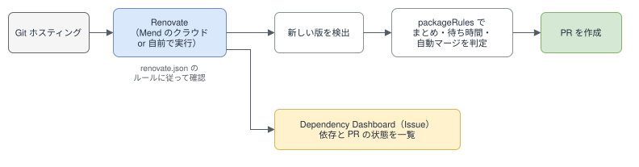
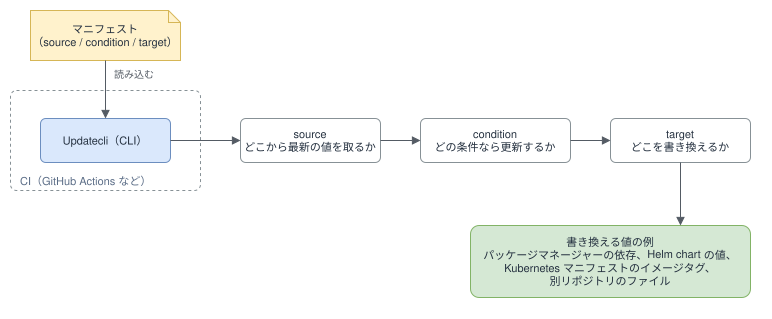
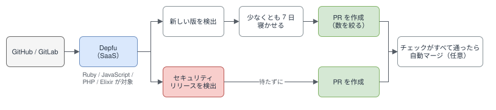

# 依存の更新 PR を何に作らせるか

ライブラリやコンテナイメージなどの依存を、新しい版が出たら PR で上げる仕組みを比べる。
GitHub に組み込まれた **Dependabot** と、OSS の **Renovate** を中心に、宣言的な更新エンジンの **Updatecli**、有料 SaaS の **Depfu** を並べる。
あわせて、更新 bot と混同されやすい脆弱性スキャナー（Snyk、Socket など）との役割の違いを整理する。

本ファイルは特定のクラウドに属さない Git ホスティングまわりの構成のため、`cross-cloud/` に置く。

## 1. 解きたい課題と前提

依存の更新を自動化したくなるのは、次のような場合である。

- 依存を手で上げる作業が後回しになり、メジャー版を何世代も飛ばして上げる羽目になる。
- 脆弱性が公開されたとき、どのリポジトリのどの依存を上げればよいかすぐにわからない。
- npm や pip のパッケージだけでなく、Dockerfile のベースイメージ、GitHub Actions のアクション、Terraform のプロバイダーなども古いまま放置されている。
- 更新 PR が多すぎて、レビューとマージが追いつかない。

前提は次のとおりとする。

- 主な Git ホスティングは github.com とし、GitLab などを併用する場合にも触れる。
- 更新 PR の自動マージの仕組みは [GitHub の PR をどう自動マージするか](github-pr-auto-merge.md) で扱い、ここでは扱わない。
- 機能と料金は執筆時点（2026 年 11 月）の値を使う。

## 2. 構成

<!-- 図は draw.io で images/dependency-update-bot-*.drawio.svg を開けば編集できる -->

### A. Dependabot



- GitHub に組み込まれており、`.github/dependabot.yml` を置くだけで動く。実行環境を用意する必要はない。
- 更新には 2 種類ある。新しい版に追従する **version updates** と、脆弱性が公開された依存だけを上げる **security updates** である。security updates は Dependabot alerts と連動し、設定ファイルがなくても有効にできる。
- 同じエコシステム内の複数の更新を 1 つの PR にまとめるには `groups` を使う。2026 年 2 月には、複数ディレクトリにある同じ依存もまとめられるようになった[^multi-directory]。
- エコシステムをまたいで（npm と Docker など）まとめるには、`groups` ではなくトップレベルの `multi-ecosystem-groups` を使う。2025 年 7 月に一般提供になった[^multi-ecosystem]。
- 2026 年 7 月から、version updates は新しい版の公開から **3 日待ってから** PR を作るのが既定になった[^cooldown]。乗っ取られたアカウントから公開された悪性の版や、すぐに取り下げられる壊れた版を踏みにくくなる。security updates は待たない。日数は `cooldown` で変えられ、無効にもできる。
- GitHub 以外の Git ホスティングでは使えない。GitLab 向けにはコミュニティの移植版（dependabot-gitlab）があるが、GitHub の公式な提供ではない。

次は、既定の 3 日を 7 日に延ばし、メジャー更新だけさらに 14 日待たせる例である。

```yaml
version: 2
updates:
  - package-ecosystem: npm
    directory: /
    schedule:
      interval: weekly
    cooldown:
      default-days: 7
      semver-major-days: 14
    groups:
      minor-and-patch:
        update-types: [minor, patch]
```

### B. Renovate



- OSS の更新 bot で、Mend が開発している。GitHub、GitLab、Bitbucket、Azure DevOps、Gitea などで動く。
- 対応する manager（依存ファイルの種類ごとの解析器）は 120 を超える[^renovate-managers]。Dependabot が対応しない種類のファイルも扱えることが多い。
- 設定は `renovate.json` に書く。`config:recommended` のような共有の設定セット（preset）を継承し、差分だけを書く運用ができる。組織で共通の preset を 1 つのリポジトリに置き、各リポジトリから参照することもできる。
- `packageRules` で、依存の名前や更新の種類ごとに、まとめ方、待ち時間（`minimumReleaseAge`）、自動マージ、スケジュールを細かく決められる。待ち時間は、preset に `config:best-practices` を使えば npm の依存が既定で 3 日になる（`config:recommended` では既定の待ち時間はない）[^renovate-age]。
- `customManagers` で、正規表現にマッチした箇所を更新対象にできる。Dockerfile の `ARG` で指定したツールの版や、README に書いた版番号なども上げられる。
- **Dependency Dashboard** という Issue に、検出した依存、開いている PR、保留中の更新を一覧する。チェックボックスで更新の再実行や保留の解除もできる。
- 実行方法は 2 つある。
  - **Mend Renovate Cloud**: GitHub なら GitHub App を入れるだけで、Mend のクラウドで動く。無料の Community Cloud と、有料の Enterprise Cloud がある[^mend-tiers]。
  - **自前で実行**: npm パッケージや Docker イメージとして配布されており、GitHub Actions（`renovatebot/github-action`）や GitLab CI、cron などで動かす。実行環境とトークン（GitHub App か個人アクセストークン）は自分で用意する。

Mend Renovate Cloud の枠は次のとおりである[^mend-tiers]。

| プラン                  | 同時に動くジョブ（Organization 単位） | 実行間隔                              | 補足                                                 |
| ----------------------- | ------------------------------------- | ------------------------------------- | ---------------------------------------------------- |
| Community Cloud（無料） | 1                                     | 4 時間ごと                            | Merge Confidence Workflows なし                      |
| Community (OSS) Cloud   | 2                                     | 4 時間ごと                            | OSI のライセンスの OSS が申請できる。審査あり        |
| Enterprise Cloud        | 16                                    | 1 時間ごと（Bitbucket は 4 時間ごと） | 有料。サポートあり。料金は営業との個別の契約で決まる |

Merge Confidence は、公開からの経過時間、他のリポジトリでの採用率、テストの通過率などをもとに、更新の安全さの目安を PR にバッジで表示する機能である[^merge-confidence]。
バッジはどのプランでも表示される。
Community Cloud で使えないのは、この目安をもとに自動マージやまとめ方を制御する Merge Confidence Workflows である。

### C. Updatecli



- Go 製の、宣言的な更新エンジンである[^updatecli]。「どこから最新の値を取るか（source）」「どの条件なら更新するか（condition）」「どこを書き換えるか（target）」をマニフェストに書く。
- パッケージマネージャーの依存に限らず、Helm chart の値、Kubernetes マニフェストのイメージタグ、別リポジトリのファイルなど、任意の値を更新できる。複数のリポジトリにまたがる更新の手順も書ける。
- 依存ファイルを自動で見つける機能（autodiscovery）もあるが、基本はマニフェストを自分で書く。A や B より手間がかかる。
- CLI として配布されており、GitHub Actions などの CI で動かす。実験的なダッシュボードはあるが、実行環境の SaaS はない。
- k3s[^k3s] や Jenkins の基盤[^jenkins-infra]のように、自分たちのソフトウェアや基盤に含まれる版を追従させる用途で使われている。

### D. Depfu



- Ruby（Bundler）、JavaScript（npm / Yarn / pnpm）、PHP（Composer）、Elixir（Hex）に絞った有料の SaaS である。GitHub と GitLab に対応する。
- 対応するエコシステムが少ない代わりに、PR が増えすぎない運用を既定にしている。開いておく更新 PR の数を絞り、"reasonably up to date" という方針で新しい版を少なくとも 7 日寝かせてから PR を作る（セキュリティリリースは待たない）[^depfu-rutd]。
- ステータスチェックがすべて通ったら自動でマージする設定もある。対象は dev / runtime の別や SemVer の種別で絞れる[^depfu-automerge]。
- パブリックリポジトリと、個人アカウントのリポジトリ（プライベートを含む）は無料である。Organization のプライベートリポジトリは数に応じた月額で、Starter（5 リポジトリ、29 USD/月）、Team（25 リポジトリ、59 USD/月）、Business（100 リポジトリ、99 USD/月）がある[^depfu]。

### 更新 bot と脆弱性スキャナーの違い

更新 bot の主な役割は、新しい版への追従である。
既知の脆弱性への対応もできるが、それは Dependabot alerts や OSV など、外部の脆弱性データベースに載った情報に頼っている。
まだデータベースに載っていない、公開直後の悪性のパッケージは検出できない。

更新 bot と並べて比べられやすいツールに、次のようなものがある。
これらは **脆弱性や悪性のパッケージを検出する** のが主な役割で、依存全体を新しい版に追従させる運用までは受け持たないことが多い。
更新 bot と併用する。

| ツール             | 主な役割                                                                                               |
| ------------------ | ------------------------------------------------------------------------------------------------------ |
| Snyk Open Source   | 依存の脆弱性を検出する。修正の PR も作れる。有料（無料の枠あり）                                       |
| Socket             | パッケージが実際に何をするか（インストール時のスクリプト、通信など）を見て、悪性のパッケージを検出する |
| OSV-Scanner、Trivy | OSS のスキャナー。CI に組み込み、依存の既知の脆弱性を検出する                                          |

## 3. トレードオフ

### 機能の差

| 観点                           | A: Dependabot                    | B: Renovate                                                                | C: Updatecli        | D: Depfu              |
| ------------------------------ | -------------------------------- | -------------------------------------------------------------------------- | ------------------- | --------------------- |
| 対応する Git ホスティング      | GitHub のみ                      | GitHub、GitLab、Bitbucket、Azure DevOps など                               | CI で動けばどこでも | GitHub、GitLab        |
| 対応する依存ファイルの種類     | 30 を超えるエコシステム          | 120 を超える manager                                                       | 任意（自分で書く）  | 4 つのエコシステム    |
| 正規表現で任意のファイルを更新 | 不可                             | 可（`customManagers`）                                                     | 可（本来の用途）    | 不可                  |
| PR のまとめ方                  | `groups`                         | `packageRules` で細かく指定                                                | マニフェスト単位    | 少ない PR が既定      |
| 公開直後の版を待つ             | 既定で 3 日（`cooldown`）        | `minimumReleaseAge` で指定。`config:best-practices` なら npm は既定で 3 日 | 条件を自分で書く    | 既定で少なくとも 7 日 |
| 依存と PR の状態の一覧         | 依存グラフの画面で見る           | Dependency Dashboard（Issue）                                              | なし                | Web の画面            |
| 自動マージ                     | Actions と組み合わせて自分で書く | 設定だけで有効にできる                                                     | 自分で書く          | 設定で有効にできる    |
| 脆弱性の修正 PR                | Dependabot alerts と一体         | GitHub の alerts や OSV のデータを使う                                     | なし                | なし                  |

### コスト

| 構成                  | 費用                                                                        |
| --------------------- | --------------------------------------------------------------------------- |
| A                     | 無料                                                                        |
| B（Community Cloud）  | 無料。ただし Organization ごとに同時 1 ジョブ、4 時間ごとの実行             |
| B（自前で実行）       | Actions の実行分数か、自分の実行環境の費用                                  |
| B（Enterprise Cloud） | 個別の契約                                                                  |
| C                     | Actions の実行分数か、自分の実行環境の費用                                  |
| D                     | 個人アカウントは無料。Organization のプライベートリポジトリは 29〜99 USD/月 |

Renovate の Community Cloud は、Organization 内のアクティブなリポジトリが増えると、1 つのジョブを順番に回すため更新が遅れやすい。
アクティブなリポジトリが多い Organization では、自前で実行するか Enterprise Cloud にするかを検討する。

### 運用負荷

1. A: 設定ファイルを置くだけ。実行環境もトークンも要らない。
2. B（Mend のクラウド）: GitHub App を入れ、設定ファイルを置く。設定できる項目が多く、ルールを詰めるほど設定の読み書きに慣れが要る。
3. D: SaaS に登録するだけだが、対応するエコシステムが少ないため、他のツールと併用することが多い。
4. B（自前で実行）: 実行環境、トークンの発行と更新、Renovate 自体の版の追従が加わる。
5. C: 更新したい値ごとにマニフェストを書いて保守する。

### ロックイン

- A は GitHub に固定される。GitLab などに移るときは、B か移行先の仕組みに書き直す。
- B は OSS であり、Mend のクラウドから自前の実行に移っても設定ファイルはそのまま使える。Git ホスティングを移っても、多くの設定はそのまま使える。
- C も OSS であり、マニフェストは CI を選ばない。
- D は SaaS の設定に依存するが、設定が少ないため、外すときの手間も小さい。

## 4. 選ぶ基準

A（Dependabot）が向くのは次のような場合である。

- GitHub だけを使い、設定にかける手間を最小にしたい。
- 更新したいのが、Dependabot が対応するパッケージマネージャーの依存だけである。
- security updates と Dependabot alerts を、GitHub の画面で一体で扱いたい。

B（Renovate）が向くのは次のような場合である。

- GitLab や Bitbucket など、GitHub 以外の Git ホスティングも使う。
- モノレポで、更新のまとめ方や待ち時間、自動マージの条件を依存ごとに細かく決めたい。
- Dockerfile の `ARG`、Terraform、GitHub Actions、README の版番号など、パッケージマネージャーの外にある版も上げたい。
- 複数のリポジトリで、更新のルールを preset として共有したい。

C（Updatecli）が向くのは次のような場合である。

- 更新したいのが、Helm の値や配布物に含まれる版など、B の `customManagers` でも書きにくい値である。
- 複数のリポジトリにまたがる更新の手順を、コードとして管理したい。

D（Depfu）が向くのは次のような場合である。

- Ruby や JavaScript のプロジェクトだけで、設定せずに PR の数を抑えた更新がほしい。

どれを選んでも、更新 bot が扱えるのは脆弱性データベースに載った既知の脆弱性までである。
公開直後の悪性のパッケージ（サプライチェーン攻撃）への備えが要る場合は、待ち時間の設定に加えて、Socket などの振る舞いを解析するスキャナーを別に入れる。

[^multi-ecosystem]: [Single pull request for Dependabot (multi-ecosystem support)](https://github.blog/changelog/2025-07-01-single-pull-request-for-dependabot-multi-ecosystem-support/) を参照。

[^multi-directory]: [Dependabot can group updates by dependency name across multiple directories](https://github.blog/changelog/2026-02-24-dependabot-can-group-updates-by-dependency-name-across-multiple-directories/) を参照。

[^cooldown]: [Dependabot version updates introduce default package cooldown](https://github.blog/changelog/2026-07-14-dependabot-version-updates-introduce-default-package-cooldown/) を参照。GitHub Enterprise Server には 3.23 で入る。

[^mend-tiers]: [Mend Renovate Cloud resource tiers](https://docs.mend.io/renovate/latest/mend-renovate-cloud-resource-tiers) を参照。

[^renovate-managers]: [Renovate の Managers](https://docs.renovatebot.com/modules/manager/) を参照。正規表現などで定義する `custom` を含む数。Dependabot のエコシステムとは数え方の単位が違う。

[^renovate-age]: [Renovate の Minimum Release Age](https://docs.renovatebot.com/key-concepts/minimum-release-age/) を参照。

[^merge-confidence]: [Renovate の Merge Confidence](https://docs.renovatebot.com/merge-confidence/) を参照。

[^updatecli]: [Updatecli: but why](https://updatecli.io/blog/but-why) を参照。

[^k3s]: [k3s の updatecli ディレクトリ](https://github.com/k3s-io/k3s/tree/main/updatecli) を参照。

[^jenkins-infra]: [Updatecli の Jenkins infra の事例](https://updatecli.io/docs/automate/jenkins) を参照。

[^depfu-rutd]: [Depfu の Reasonably up to date](https://docs.depfu.com/article/36-reasonably-up-to-date) を参照。

[^depfu-automerge]: [Depfu の Auto-merge, Nightshift and auto-activation](https://depfu.com/blog/auto-merge-nightshift-and-auto-activation) を参照。

[^depfu]: 料金は変わることがある。最新の値は [Depfu の料金](https://depfu.com/pricing) を参照。
